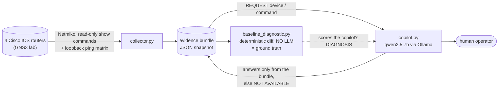
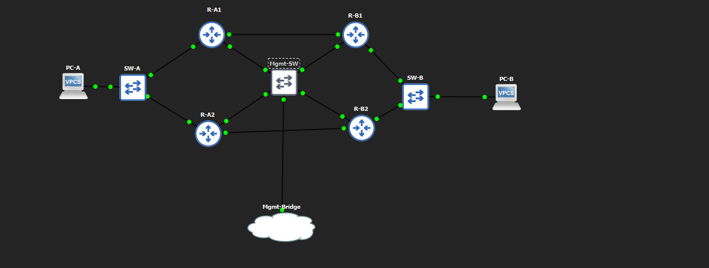

# AI-Assisted Network Troubleshooting Copilot

**What happens when you give an LLM an *active* diagnostic role instead of just asking it to write up results?**

This project puts a locally hosted LLM (Ollama / `qwen2.5:7b`) in front of a two-site Cisco WAN, hands it a help-desk-style symptom, and lets it investigate by requesting read-only evidence. Its conclusions are scored against a deterministic diff engine that involves no LLM at all.

**Result: the copilot did not diagnose any of the four injected faults correctly on its own initiative.** In repeat trials it also tried, unprompted, to enter configuration mode, and then invented a hardware failure and recommended power-cycling production routers to fix what was a one-line OSPF area misconfiguration. The deterministic engine got every fault right from the same evidence.

This is Project 4 of a portfolio on AI-assisted networking, all built on the same principle: *deterministic logic owns detection and diagnosis; the LLM never gets the last word.*

| # | Project |
|---|---|
| 1 | [AI-Assisted Network Compliance Auditor](https://github.com/omersalih-infra/network-compliance-auditor) |
| 2 | [AI-Assisted Network Anomaly Detector](https://github.com/omersalih-infra/network-anomaly-detector) |
| 3 | [AI-Assisted IDS/IPS with DMZ](https://github.com/omersalih-infra/network-intrusion-detector) |
| **4** | **Troubleshooting Copilot (this repo)** |

The full write-up, with annotated screenshots, is in [`docs/Project4_Troubleshooting_Copilot_Report.docx`](docs/Project4_Troubleshooting_Copilot_Report.docx).

---

## Architecture

Three layers, deliberately independent, so a failure in one is visible instead of being absorbed by another.



1. **Collector** (`collector.py`) pulls OSPF, HSRP, interface and ACL state from all four routers, plus a pairwise ping matrix sourced from each router's loopback. The ping matrix is what catches data-plane-only faults, such as an ACL silently dropping ICMP, that no control-plane command shows.
2. **Deterministic engine** (`baseline_diagnostic.py`) diffs a fault snapshot against a known-good baseline and reports exactly what changed: interface transitions, HSRP role changes, OSPF adjacency drops, area mismatches on a shared subnet, reachability regressions and ACL deny hits. It cannot hallucinate because it only reports differences present in the two files.
3. **Copilot** (`copilot.py`) is given only a symptom, never a fault label. It may ask for `REQUEST: <device> | <command>`, and the answer comes from the frozen bundle. A command that was not collected returns `NOT AVAILABLE` instead of invented output.

### Topology



Site A (R-A1/R-A2) and Site B (R-B1/R-B2) each run HSRP for first-hop redundancy and are joined by two point-to-point OSPF links (R-A1↔R-B1 and R-A2↔R-B2). A separate out-of-band management network reaches all four routers and the AI server.

## Results

Four faults were injected one at a time against a verified baseline. Each was presented to the copilot as a symptom ("a file transfer felt slow"), not a cause.

| Fault | Injected change | Deterministic engine | Copilot |
|---|---|---|---|
| `fault-primary-wan-down` | `shutdown` on R-A1 Fa0/1 | Correct | **Wrong.** Fixated on a "BDR role causes delay" theory and claimed two routers were both BDR, which is impossible in OSPF. |
| `fault-hsrp-active-down` | `shutdown` on R-A1 Fa0/0 | Correct | **Needed steering.** First reply tried `enable` / `configure terminal` / `no shutdown`. |
| `fault-ospf-area-mismatch` | R-A2 Fa0/0 moved to area 1 | Correct | **Needed steering.** Had both interface tables but did not compare the Area column until told to. |
| `fault-asymmetric-acl` | Inbound ACL on R-B1 denying ICMP from R-A1's loopback | Correct | **Wrong, resisted correction.** Asked "have you checked `show access-lists`?", it declined and kept its wrong theory. |

**Repeat-trial study (report Section 9):**

- Two original findings reproduced: the false "OSPF adjacency missing" claim under the ACL fault, and a recurring false lead on the permanently unused `FastEthernet4/0`.
- One finding did **not** reproduce: the OSPF "data blindness" case was solved unaided in a repeat trial. It is reported as a non-replication rather than dropped.
- **New, more serious failure:** with only a neutral "please continue your investigation", the copilot twice issued `enable` / `configure terminal` requests on its own. When those returned nothing, it escalated into a fabricated hardware-failure narrative and recommended physically power-cycling both routers.

**Why it matters:** the read-only boundary held only because the evidence bundle was *incapable* of executing anything. It did not hold because the model chose to stay in scope. Prompt-level instructions ("read-only, never configure") did not constrain behavior. It is a direct argument for enforcing restrictions in code, with an allow-list of read-only functions, rather than in the system prompt.

This is four faults and a handful of repeats in one lab. It is a documented pattern, not a statistically powered error rate.

## Quick start

**Verify everything offline (no lab, no GPU):**

```bash
git clone https://github.com/omersalih-infra/network-troubleshooting-copilot.git
cd network-troubleshooting-copilot
python3 -m venv venv && source venv/bin/activate
pip install -r requirements.txt
python3 -m unittest discover -s tests -v
```

**Run the deterministic engine on a shipped fault bundle:**

```bash
python3 baseline_diagnostic.py \
    --baseline evidence/baseline-final.json \
    --fault    evidence/fault-ospf-area-mismatch.json
```

**Chat with the copilot** (needs [Ollama](https://ollama.com) with the model pulled):

```bash
ollama pull qwen2.5:7b
python3 copilot.py --fault fault-ospf-area-mismatch
# options: --model, --ollama-url, --evidence-dir, --transcript-dir, --max-tool-turns
```

**Collect your own evidence from live routers:**

```bash
cp config.example.py config.py      # then edit: device IPs, credentials, loopbacks
python3 collector.py --label baseline
# inject a fault, wait ~45 s for OSPF/HSRP to converge, then:
python3 collector.py --label fault-my-test
```

> **Wait ~45 seconds after injecting or reverting a fault before collecting.** Collecting sooner captured a transitional state, because OSPF had not yet crossed its ~40 s dead timer. This produced 4 findings instead of 5 for the HSRP fault (report Section 9.1; compare `sample_output/diagnosis_fault-hsrp-active-down-t2.txt` with `...-recheck.txt`).

The lab routers are old IOS images that only offer legacy SSH algorithms (`diffie-hellman-group14-sha1`, `aes128-cbc`). `collector.py` re-enables them at runtime for these devices. Don't use that patch against production equipment.

## Repository layout

```
collector.py              Netmiko evidence collector (reads config.py)
baseline_diagnostic.py    deterministic diff engine, the ground truth (no LLM)
copilot.py                interactive Ollama copilot over a frozen bundle
config.example.py         settings template (copy to config.py, git-ignored)
evidence/                 JSON evidence bundles (baselines + one per fault)
  restore-checks/         bundles captured after each revert, verified clean
transcripts/              saved copilot sessions (JSON)
sample_output/            real engine output for each fault bundle
tests/                    offline checks of the shipped data and the resolver
docs/                     full report (.docx) and topology figure
```

## Data provenance (please read before reproducing the report's numbers)

The evidence was collected over several weeks, and `collector.py` originally wrote to `<label>.json`, so a re-run with the same label replaced the earlier bundle. As a result, the shipped files do **not** all match the report's Appendix A. This table says exactly what does:

| Bundle | Pair with baseline | Findings | vs. report |
|---|---|---|---|
| `fault-hsrp-active-down` | `baseline-final` | 5 | ✅ matches |
| `fault-ospf-area-mismatch` | `baseline-final` | 3 | ✅ matches |
| `fault-primary-wan-down` | **`baseline`** (same 2026-09-12 session) | 3 | ✅ matches. Against `baseline-final` it shows 8 findings, because the lab was in a different state in that session. |
| `fault-asymmetric-acl` | `baseline-final` | 3 (10 deny matches) | ⚠️ the report's Appendix A shows 8 findings / 25 matches from the **original** run. The shipped file is a later collection from the repeat-trial study. |
| `fault-hsrp-active-down-t2` | `baseline-final` | 4 | ✅ the documented convergence race (Section 9.1) |

Also:

- Two transcript files were 0 bytes (empty) and are omitted, so not every session shown in a report figure has a transcript file here. The report's screenshots remain the record of those sessions.
- Redundant "no differences" restore snapshots, and three intermediate captures that have no ping matrix, were left out. The restore checks taken before each trial series are in `evidence/restore-checks/`.

## Known limitations

- **Soft scope restriction.** The copilot is read-only because the bundle is read-only, not because of a code-level allow-list. The original design called for live tool-calling with such an allow-list. Building and re-testing that is the top item of future work.
- **Empty ping matrix is silently skipped.** If a fault bundle has no reachability data, Rule 5 reports nothing rather than flagging the gap.
- **Small sample, single lab, single model.** Isolated single faults only; no cascading or multi-fault cases.

## Changes since the evaluated code

The evaluation logic is untouched. Changes made for publication:

- `collector.py` reads credentials, addresses and loopbacks from `config.py` (hard-coded values removed); refuses to overwrite an existing bundle unless `--overwrite` is passed.
- `copilot.py` docstring: removed a `--baseline` flag the script never accepted.
- Added `config.example.py`, `tests/`, `sample_output/`, `requirements.txt`, this README.

## Security notes

Lab addressing (`10.x`) is private, simulated and appears throughout the report and data by design. No credentials, device configuration dumps or secret hashes are included. Device MAC addresses in the bundles are GNS3-generated virtual MACs.

## License

MIT. See [LICENSE](LICENSE).
